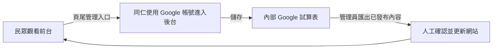

# 前台與後台怎麼連在一起

前台給民眾看計畫、機構、課程與公告。後台給同仁管理內容。它們是兩個獨立網站，前台的管理入口會以新分頁開啟後台。

| 入口 | 用途 |
| --- | --- |
| [公開前台](https://ccsa-ai-empowerment.vercel.app/) | 民眾閱讀計畫與公開內容 |
| [前台管理入口](https://ccsa-ai-empowerment.vercel.app/admin) | 導向 Google 帳號授權的管理後台；需要部署含此頁的 2A 前台版本 |
| [Google 管理後台](https://script.google.com/macros/s/AKfycbzbuYPupTD3fHt9a9LkGTOQGPixP6eoYgKHTk1htNFKiOu2jKpVi3I7q5QX9i5GHonwbA/exec) | 已授權同仁登入、預覽與管理資料 |

## 點入口與更新內容，是兩個步驟

入口連結只會開啟另一個網站，不會分享 Google 試算表、開啟寫入權限或同步資料。知道後台網址的人仍須通過 Google 身分、白名單與試算表權限檢查。多人管理尚未驗收時維持多人寫入關閉；僅有本人操作時可依 [擁有者專用模式](./2A-擁有者啟用與發布練習.md) 限定試算表擁有者寫入。

日後開放編輯後，以課程為例：同仁新增一堂課並儲存草稿，資料先進入內部試算表；完成確認並設為已發布，再匯出公開資料檔，交由網站維護人員更新網站。更新部署完成後，民眾才會在前台看到課程。單純儲存、發布狀態變更或下架，不會立即改變目前的公開網站。

## 為什麼 Google 後台打得開，前台 /admin 卻是 404

Google Apps Script 與 Vercel 各有自己的程式版本及部署。把後台程式貼入 Google 並部署，不會更新 Vercel 的 React 前台。若前台仍顯示站內 404，須把本專案的 2A 前台程式提交到 GitHub，並讓 Vercel 部署該版本。只重做 Google 初始化，或重新部署舊的 GitHub 提交，都不會新增前台管理入口。

本次整合包含 `/admin` 頁面、頁尾連結及 `src/config/site.ts` 中的公開後台網址。更新前台後，正常流程應是「首頁 → 頁尾管理入口 → 使用 Google 帳號前往管理後台 → 新分頁的 Google 後台」。手機頁尾的管理入口與回到頂端按鈕使用分別的定位，避免互相遮住。

## 維護人員的更新方式

1. 將完整的 2A 程式變更推送到同一 GitHub Repository，先用分支及 Vercel 預覽測試。
2. 前台已預設使用上表的 Google 後台網址。若要替換，可在 Vercel 設定公開環境變數 `VITE_ADMIN_URL`，值須為新的 HTTPS `/exec` 網址，再重新建置。明確設定為空值會停用入口；若先前有空白設定，請刪除該覆寫值或填入正確網址。
3. 正式內容模式維持 `published`。試算表 ID、管理員帳號與憑證只留在 Google 後端設定，不放進 Vercel 前台。
4. 預覽確認 `/admin` 直連、首頁頁尾點擊、手機點擊及後台目標網址後，再依既有流程更新正式版本。
5. 更新入口不會解除後台的唯讀鎖；寫入模式須另依部署文件啟用，跨帳號安全驗收仍保留。

技術驗證範圍：本機瀏覽器測試驗證入口、目標網址、新分頁與公開資料契約。若檢查環境無法連上外部網站，不能以本機通過宣稱線上版本已更新；正式部署完成後，仍須由可連線的瀏覽器確認。
