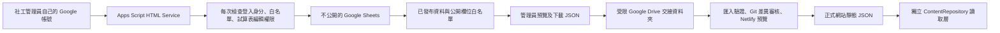

# 2A 整合與資料結構

保留 React 19、TypeScript、Vite 6、Tailwind 4、React Router、既有視覺、成果庫、學習資源、Netlify 與 Vercel 設定。後台在 Google Apps Script HTML Service 執行，沒有另外建立 React 後台或帳密系統。所有程式均放在同一個 Repository。

## 檔案位置

| 路徑 | 用途 |
| --- | --- |
| `apps-script/Schema.gs` | 六張工作表欄位、驗證、公開欄位白名單 |
| `apps-script/Setup.gs` | 擁有者執行的初始化、白名單新增、停止寫入 |
| `apps-script/Server.gs` | 每次授權、CRUD、鎖定、版本檢查、操作紀錄、匯出 |
| `apps-script/Index.html` | 無額外套件的繁中響應式管理介面 |
| `apps-script/appsscript.json` | V8、臺北時區、明確 OAuth scopes、存取者執行設定 |
| `src/data/repository.tsx` | `ContentRepository` 介面及靜態 JSON adapter |
| `src/data/public-contract.mjs` | 網站與匯入工具共用的公開資料檢查 |
| `scripts/import-public.mjs` | 人工交接 JSON 的受控匯入工具 |
| `public/data/content.json` | 唯一可交給網站的核准快照，初始為空清單 |

## 六張固定工作表

所有表的前五欄順序固定為 `id, createdAt, updatedAt, status, version`。ID 為類別前綴加 UUID，由伺服器產生，與列號無關。時間為 ISO 8601 字串，版本為正整數，每次修改加一。不得重排、改名或刪除欄位；日期欄位保留 `YYYY-MM-DD` 純文字，避免試算表自動轉換時區。

| 表 | 後續欄位（順序固定） | 主要驗證 |
| --- | --- | --- |
| Organizations | name, city, region, summary, features, aiDirection, logoUrl, internalNotes | 名稱、縣市、區域、簡介必填；Logo 為核准的 HTTPS PNG/JPG/WebP |
| Courses | title, category, description, date, time, location, audience, agenda, registrationUrl, registrationStatus, organizationId, internalNotes | 名稱、分類、說明、日期、地點、對象、報名狀態必填；開放報名需 Google Forms 網址 |
| Announcements | title, category, summary, content, date, internalNotes | 全部公開文字及日期必填；分類固定；純文字顯示 |
| Recruitment | startDate, endDate, recruitmentStatus, formUrl, resultsUrl, description, internalNotes | 單筆設定；開放需起訖日期；截止不得早於開始；保留既有 Google Forms |
| AdminUsers | email, displayName | UUID、狀態及時間由初始化／私人編輯器工具維護；email 格式驗證 |
| AuditLogs | actor, action, entity, recordId, outcome, errorCode | 系統產生；記錄事件、操作者與資料ID，不記錄內容或前後個資 |

業務資料狀態為 `draft` 草稿、`pending_review` 待審核、`published` 已發布、`archived` 已下架。公告及招募不使用待審核。AdminUsers 的 `published` 表示啟用、`archived` 表示停用；此表永不公開。AuditLogs 的 status 固定為 archived，結果另用 pending/applied/failed 表示，永不公開。

機構ID可供後續 AI 治理指引及成果案例的 `organizationId` 使用。本次課程先支援選填關聯；發布時關聯機構必須公開，下架或刪除機構前會檢查關聯。文件上傳、機構登入、兒少名冊、成果審核及大量 Email 未加入本次系統。

## 授權與一致性

每個 RPC（包含列表、單筆讀取、首頁、預覽及下載）都由伺服器讀取 `Session.getActiveUser().getEmail()`，拒絕空值，並確認等於有效執行者；再以當前使用者授權讀取 Drive `capabilities.canEdit`，確認試算表可編輯，最後檢查 AdminUsers 啟用白名單。前端不能提供登入 email。AdminUsers、AuditLogs 沒有 CRUD RPC；初始化及輔助函式名稱皆以 `_` 結尾，不能由 `google.script.run` 呼叫。沒有 doPost、匿名寫入端點、API 密鑰或 owner-token 代理。

白名單整張工作表由初始化程式保護，只允許試算表擁有者維護。其他管理員只需試算表權限，不需 Apps Script 專案編輯權。新增管理員必須透過擁有者的私人設定工具，並另外分享試算表。試算表及 Apps Script 擁有者是受信任維護人員；有權修改伺服器程式或移除保護的人可以改變安全界線。

儲存使用 ScriptLock，取得鎖後重新授權；更新及刪除需符合讀取時版本，避免多人互相覆蓋。先寫 pending 操作紀錄，成功後標記 applied；內容失敗標記 failed。Google Sheets 不提供跨表交易，遇到逾時、部分寫入或稽核完成失敗，必須先重新讀取及人工核對，不自動重試新增。

AuditLogs 是作業追蹤，並非防竄改的法遵稽核庫。試算表編輯者仍可能直接修改資料或操作紀錄；需限制分享對象並搭配版本紀錄及受限備份。這是要求所有管理員具試算表權限的架構限制。不要在此系統保存兒少個資、私人聯絡名冊或敏感審查文件。

## 公開快照

只選 published 資料，重新驗證手動更改過的表格內容，再逐欄建立公開物件。完全不讀取白名單或稽核表作為匯出來源，不包含內部備註、版本、建立修改時間或操作者。四種公開模型的欄位以 `Schema.gs` 的 publicFields 與 `public-contract.mjs` 為準，契約相容性有測試。

`schemaVersion` 為 1；根欄位固定為 `schemaVersion, generatedAt, organizations, courses, announcements, recruitment`。Recruitment 無公開設定時為 null。匯入工具與瀏覽器會拒絕未知欄位、重複ID、不安全網址、不支援版本及不完整的機構關聯。白名單無法判斷自由文字是否暗含個資，必須另行人工審閱公開授權及內容。

正式模式讀取快照為空或失敗時，不會回退示範課程。`VITE_CONTENT_MODE=demo` 僅供既有設計的展示與回歸測試。既有示範成果庫與資源仍保留，並繼續明確標示為示範。網站無權連線內部 Sheet，也沒有自動發布或自動修改 GitHub 的功能。
